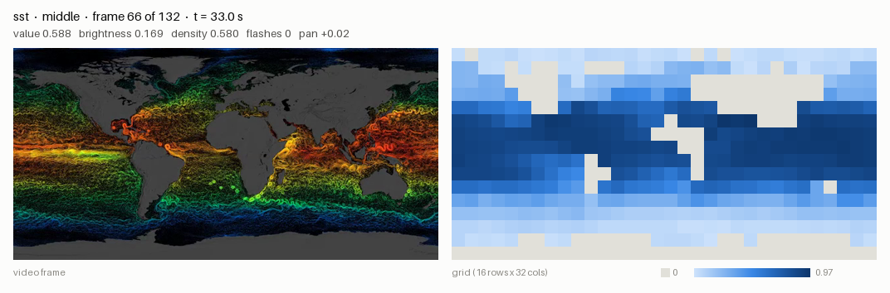
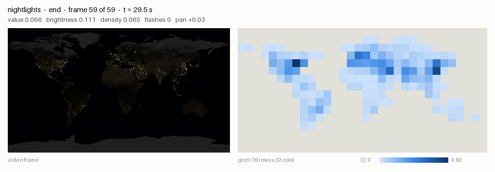
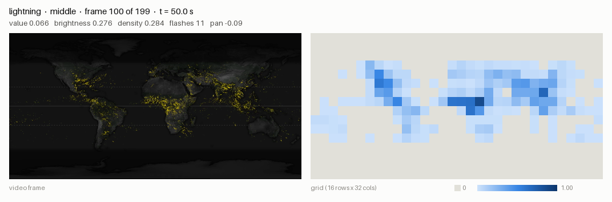
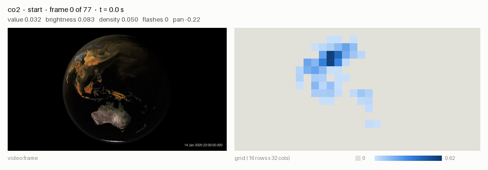

# The Data Story: from NASA videos to sound

The Earth Information Jukebox lets you *listen* to our planet: pick a NASA visualization, and music plays along with the video, changing as the picture changes, so people who are blind or have low vision can follow Earth science too. Sound can't be made from pixels, though. A synthesizer needs numbers such as "how loud", "how high" and "left or right". So for every video, we measured the picture and turned it into a short list of numbers for every half-second.

## How it works

**NASA video → still frames → measurements → `features.json` → sound and screen reader**

We download each visualization from NASA's Scientific Visualization Studio (SVS) and take two still frames per second. A Python program measures every frame and saves the results in `features.json`, a plain text file of numbers. In the browser, the jukebox reads those numbers in time with the video and turns them into music, screen-reader descriptions and an explore mode.

### The seven features

Each frame gets seven numbers. Most run from 0 to 1.

- **brightness**: how bright the picture is on average, like a light meter.
- **warmth**: red against blue; 1 means very red, like a sunset compared with a clear sky.
- **density**: how much of the map is busy (bright or active), like counting the taken seats in a cinema.
- **pan**: where the activity is, from −1 (left/west) to +1 (right/east); it picks the speaker the sound comes from.
- **motion**: how much changed since the last frame, like spot-the-difference.
- **flashes**: how many new bright spots just appeared (a whole number, 0 to 16), like camera flashes in a stadium.
- **value**: the main scientific quantity, read from the map's colour scale where there is one, like reading a thermometer.

**The grid.** We also lay a 16 × 32 grid over each frame, like a chessboard with 16 rows and 32 columns. Each square holds the *value* for that area, and explore mode plays the square under your cursor.

## The four datasets

In each image, the left side is the NASA video frame and the right side is our grid as a heatmap: darker blue means a higher value, grey means exactly 0.

### Sea surface temperature (`sst`)

**What NASA shows.** Ocean currents from March 2007 to March 2008, drawn as streaks coloured by water temperature, from blue (0 °C) to red (32 °C). Source: [SVS #3912](https://svs.gsfc.nasa.gov/3912/). Credit: NASA/Goddard Space Flight Center Scientific Visualization Studio.

**What we measured.** The water temperature in every ocean area, read from the colour scale. *Value* is the global average.

**Challenges and solutions.**
- *Streaks over black ocean.* Streak tails fade toward black and overlapping streaks glow toward white, so a pixel's brightness is unreliable, but its *hue* (which colour of the rainbow it is) still matches the scale. We read every pixel by hue; only 0.05 % of coloured ocean pixels didn't fit.
- *Gaps.* Only about 39 % of ocean pixels give a reading in each frame. A square with no reading keeps its last one.
- *A fair average.* A flat map stretches the areas near the poles, so we weight each area by its real size on the globe ("area weighting").

**What the data reveals.** The warmest water, around 28 to 30 °C, forms a wide band along the equator and cools toward the poles, down to about 0 °C. The global average is about 19 °C, close to the real global mean sea surface temperature.

*Halfway through the year: the warm equatorial band shows up as the darkest rows of the grid.*

### Night lights (`nightlights`)

**What NASA shows.** Earth at night, seen by the Suomi NPP satellite, one picture per year from 2012 to 2023. Source: [SVS #5313](https://svs.gsfc.nasa.gov/5313/). Credit: NASA's Scientific Visualization Studio. Data: NASA Black Marble (Suomi NPP VIIRS).

**What we measured.** City light above the dark background map, on one fixed scale for every year so that growth shows honestly.

**Challenges and solutions.**
- *Twelve years in about 6.4 seconds.* That's too fast for music. We took one picture per year and rebuilt the timeline at **2.5 seconds per year**, with a short crossfade. The web video uses the same timeline, so picture and sound stay in sync.
- *Light above the land base.* The lights sit on a background (snow, deserts, forests) that is the same every year. We estimated that background and measured only the light above it.
- *False polar lights.* Our checks found faint "lights" in Antarctica. They were really ice-shelf edges, coastlines, ridges and bare rock, coloured blue-grey, while real lights are yellowish. Now a pixel counts only if it is yellowish (red clearly above blue). Antarctica reads 0, and the real southern lights (Punta Arenas, Río Gallegos, Puerto Deseado, Stanley) stay.

**What the data reveals.** Night lights grew by about **27 % from 2012 to 2023**, with a small dip in 2020 and a jump in 2022–2023. Growth was strongest across China, India, Southeast Asia and the Middle East, while parts of Western Europe dimmed a little. In the data, the centre of light shifts slightly east as Asia brightens." Don't change anything else.

*2023: the brightest squares match the brightest city regions, and the Antarctic rows are all grey.*

### Lightning (`lightning`)

**What NASA shows.** Lightning seen from the International Space Station (ISS) from about 2017 to 2023. Each flash is a yellow dot that stays on the map for 10 days of data. Source: [SVS #5011](https://svs.gsfc.nasa.gov/5011/). Credit: NASA's Scientific Visualization Studio. Data: Lightning Imaging Sensor (LIS) on the International Space Station.

**What we measured.** How much of each area is covered by lightning, and where new storms burst.

**Challenges and solutions.**
- *Thousands of strikes at once.* One note per dot would be noise. Instead, a **flash** is a *storm burst*: a grid square where at least 20 % of the area turned newly yellow within half a second. That gives a lively drum pattern.
- *Where to put the sound.* The Americas, Africa and Asia always have lightning at once, so the centre of *all* lightning barely moves. Here, **pan** follows the squares that just burst, so each hit sounds from where the storm happened.
- *What the ISS can't see.* It only sees between about 52° north and south, so the top and bottom rows are always 0.

**What the data reveals.** Lightning swells **7 times**, about every 12 seconds of video, once per northern summer. Most strikes are over tropical land: central Africa, the Americas and Southeast Asia are the hotspots.

*A busy moment with 11 storm bursts: the grid's hotspots match the yellow clusters, and the rows the ISS can't see stay grey.*

### Carbon dioxide (`co2`)

**What NASA shows.** A computer model of carbon dioxide from 14 January to 3 March 2020 on a turning 3D globe. Orange and red patches show where it is highest near the ground. Source: [SVS #5196](https://svs.gsfc.nasa.gov/5196/). Credit: NASA's Scientific Visualization Studio. Data: DYAMOND GEOS model.

**What we measured.** How much high carbon dioxide is visible on the globe in each frame.

**Challenges and solutions.**
- *A rotating globe.* The camera turns about 190° westward, from East Asia past India, Africa and the Atlantic to South America, and NASA offers no flat map. So we present an honest **globe tour**: the numbers describe *what is facing you right now*.
- *A screen grid.* Because the globe turns, a square doesn't stay over one place on Earth. Our grid covers the screen, so explore mode plays what is under your cursor right now. Squares outside the globe are 0.
- *No numbers on the colour scale.* The colorbar has no ppm (parts per million) labels, so our values are *relative* positions on the scale, not real concentrations.
- *A fast daily pulse.* Ground-level carbon dioxide builds up at night and fades by day, flickering every 0.8 seconds. Each data frame averages one model day, so the sound stays smooth.

**What the data reveals.** High carbon dioxide is most visible over **East Asia** at the start and over **South America and the Amazon** at the end, and lowest while Africa and the Atlantic face the camera.

*The tour begins over East Asia: the orange patches become the darkest squares of the screen grid.*

## How we checked the data

1. **Format checks.** `scripts/validate.py` checks every file against our shared format: values in range, nothing missing, a full 16 × 32 grid in every frame. We also checked that each video matches its data in length, is 720p or smaller, has no audio and plays.
2. **Sanity checks against known facts.** Is the equator warmer than the poles? Are night lights brighter in 2023 than in 2012, with a dip in 2020? Are there seven yearly lightning peaks and nothing outside the ISS's view? Is carbon dioxide higher over East Asia and South America than over Africa? All hold, and this step is how we caught the false polar lights.
3. **Visual check.** `scripts/check_visual.py` puts each video frame next to its grid, as in the images above, so any mismatch is visible at a glance.

## Honest limits

- **Sea temperature** covers about one year (2007–2008), so it shows seasons, not a climate trend.
- **Night lights** use our re-paced timing, not NASA's, and *value* is brightness above the background (there's no colour scale). Dim lights over snow are partly missed.
- **Lightning** has no date labels, so we give no exact dates; the yearly peaks are an estimate.
- **Carbon dioxide** is relative (no ppm), follows what the camera shows rather than a global trend, and uses a screen grid, not a map.

## Credits

All visualizations are by **NASA's Scientific Visualization Studio** (NASA/Goddard Space Flight Center). Data: ECCO2 ocean model (sea temperature), NASA Black Marble from Suomi NPP VIIRS (night lights), the Lightning Imaging Sensor on the ISS (lightning) and the DYAMOND GEOS model (carbon dioxide). Audio uses Tone.js (MIT licence). Full details are in [sources.md](sources.md).
